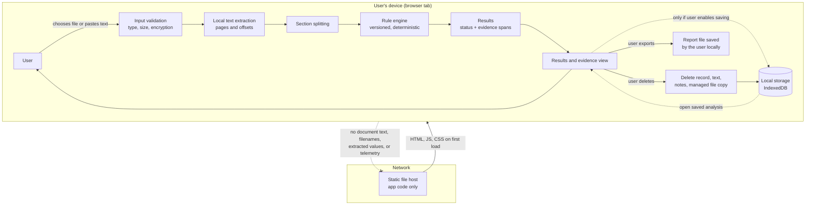

# Privacy and data flow (Phase 0)

Document contents never leave the device. There is no application server.

## What crosses the device boundary

| Direction | Data | When |
|---|---|---|
| Inbound | App code (HTML, JS, CSS, bundled libraries) | First load and updates |
| Outbound | Ordinary request for app code (as with any website) | First load and updates |
| Outbound | Document text, filenames, extracted values, notes | **Never** |
| Outbound | Analytics, crash reports | **Never** in the MVP |

## Where data lives

| Data | Location | Lifetime |
|---|---|---|
| Opened document, extracted text, results | Memory | Until the tab closes or the user discards it |
| Saved analyses (opt-in) | IndexedDB in the user's browser profile | Until the user deletes them or clears site data |
| Exported report | Wherever the user saves it | Outside the app's control |
| Original source file | Wherever the user keeps it | Outside the app's control |

## How this will be enforced and checked (Phase 2)

- Content-Security-Policy with `connect-src 'none'`; no third-party origins.
- All dependencies bundled; no runtime fetches.
- Automated test: full analysis completes with networking disabled.
- Automated test: no document text appears in console output or error messages.
- Deletion test: after "Delete analysis", no record, text, or file copy remains in storage.

These are planned controls. None is implemented or verified yet.
